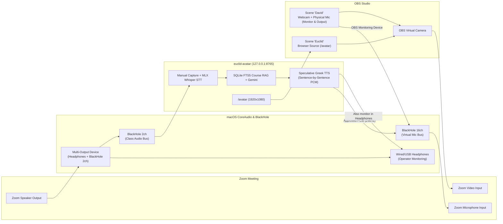

# Euclid Avatar on a Zoom Call · MATH E-139 Spike

Live "Euclid of Alexandria" avatar pipeline for Harvard Extension School **MATH E-139 (*Reading Euclid's Elements in Greek*, Fall 2026)**.

In a live class session:
1. Euclid captures a spoken question in English from the Zoom call via `BlackHole 2ch` (or manual text / operator mic override).
2. Local Apple Silicon STT (`mlx-whisper`, pre-warmed in Metal RAM) transcribes the question in **~60–150 ms**.
3. An in-memory/SQLite FTS5 BM25 + exact proposition/entity retriever queries `.cache/course_index.sqlite` (built strictly read-only from `~/Projects/Courses/26Fall/mathe139/`) in **~0.3–5 ms**.
4. A single-pass structured Gemini Flash call (`google-genai`) generates a concise 2–4 sentence answer in English paired sentence-by-sentence with its polytonic Ancient Greek translation (Heiberg/Fitzpatrick terminology).
5. **Speculative pre-synthesis:** While you review the transcript, cited course sources, English subtitle track, and Ancient Greek text in the Operator Control window (`/control`), a background worker immediately synthesizes the Greek audio sentence-by-sentence into 24 kHz mono PCM in RAM.
6. Clicking **Approve & Speak** begins playback into `BlackHole 16ch` (Zoom's microphone) in **`< 5 ms`** once Sentence 1 is pre-synthesized, driving a 60 Hz RMS-animated classical bust of Euclid with synchronized high-contrast English (and Greek) subtitles in `/avatar` (`1920x1080` OBS Browser Source).

---

## 1. Prerequisites & Installation

### System Dependencies (macOS Apple Silicon `arm64`)
Install the two separate BlackHole virtual audio drivers and FFmpeg via Homebrew:
```bash
brew install blackhole-2ch blackhole-16ch ffmpeg
```
*(Why two separate BlackHole devices? `BlackHole 2ch` carries incoming Zoom class audio into the capture pipeline, while `BlackHole 16ch` carries Euclid's voice into Zoom's microphone input. Keeping them separate prevents Euclid from hearing himself or creating a feedback loop.)*

### Python Environment (`Python 3.12+` via `uv`)
```bash
uv venv --python 3.12 .venv
source .venv/bin/activate
uv pip install -e .
```

### `.env` Configuration
Copy `.env.example` to `.env` (which is gitignored) and configure your local settings:
```bash
cp .env.example .env
```

Documented variables in `.env.example`:
| Variable | Default | Purpose |
| --- | --- | --- |
| `GEMINI_API_KEY` | *(required)* | Gemini API key for `google-genai` (never logged, printed, or committed) |
| `GEMINI_MODEL` | `gemini-3.1-flash-lite` | Low-latency Gemini model (`gemini-3.1-flash-lite`, `gemini-3-flash-preview`, `gemini-2.5-flash`) |
| `COURSE_REPO_PATH` | `~/Projects/Courses/26Fall/mathe139` | Read-only path to the MATH E-139 course repository |
| `EUCLID_TTS_PATH` | `~/Projects/codex/euclid-tts` | Read-only path to `euclid-tts` (for accepted I.23 WAV masters & Kokoro cache) |
| `TTS_BACKEND` | `google_erasmian` | `google_erasmian`, `kokoro_erasmian`, `google_modern`, or `macos_modern` |
| `TTS_VOICE_ERASMIAN` | `en-US-Neural2-D` | Google Erasmian voice (`en-US-Neural2-D` male, `en-US-Neural2-J` male, `en-US-Neural2-H` female baseline) |
| `TTS_VOICE_MODERN` | `el-GR-Wavenet-B` | Google Modern Greek voice (`el-GR-Wavenet-B`) |
| `TTS_VOICE_KOKORO` | `am_adam` | Local Kokoro-82M ONNX voice (`am_adam`, `af_heart`, `af_bella`) |
| `TTS_RATE` | `0.78` | Speaking rate (`0.72–0.82` per `euclid-tts` prosody experiments) |
| `TTS_LEVEL_SPEECH` | `true` | Apply `euclid-tts` 2:1 gentle RMS compression & `-1 dBFS` peak limiting |
| `STT_MODEL` | `mlx-community/whisper-large-v3-turbo` | Local Apple Silicon MLX Whisper model (`whisper-large-v3-turbo` or `whisper-small.en`) |
| `AUDIO_INPUT_DEVICE` | `BlackHole 2ch` | CoreAudio input device carrying Zoom class audio into capture |
| `OPERATOR_MIC_DEVICE` | `MacBook Pro Microphone` | Physical microphone for operator override / "David" scene |
| `AUDIO_OUTPUT_DEVICE` | `BlackHole 16ch` | CoreAudio output device carrying Euclid speech into Zoom's mic |

### Google Cloud TTS Authentication (for `google_erasmian` and `google_modern`)
Google Cloud TTS uses Application Default Credentials (ADC) cached at startup via `google.auth.default()`:
```bash
gcloud auth application-default login
```
*(If offline or running without Google Cloud credentials, switch `TTS_BACKEND` to `kokoro_erasmian` or `macos_modern` in `.env` or via the `/control` dropdown for 100% local synthesis.)*

---

## 2. Step-by-Step Audio & Video Routing (macOS + OBS + Zoom)



### Step 1: Verify CoreAudio Devices
Run the built-in device diagnostic:
```bash
python -m euclid_avatar devices
```
Verify that `BlackHole 2ch`, `BlackHole 16ch`, and your physical microphone/headphones are listed.

### Step 2: Configure macOS `Audio MIDI Setup` (Multi-Output Device)
1. Open **`/System/Applications/Utilities/Audio MIDI Setup.app`** (`⌘+Space` -> `Audio MIDI Setup`).
2. Click the **`+`** button at the bottom-left and choose **Create Multi-Output Device**.
3. Double-click its name and rename it **`Zoom + Euclid Monitor`**.
4. In the right pane, check **both**:
   - Your **Headphones** (e.g., `External Headphones` or `CalDigit Headphone`)
   - **`BlackHole 2ch`**
5. Set **Primary Device** (top dropdown) to your **Headphones**, ensure both devices are set to **`48,000 Hz`**, and check **Drift Correction** next to `BlackHole 2ch`.
6. *(Optional)* If you also want to hear Euclid's outgoing voice in your headphones without routing through OBS, create a second Multi-Output Device named **`Euclid Out + Headphones`** combining **`BlackHole 16ch`** + **Headphones**, and set `AUDIO_OUTPUT_DEVICE=Euclid Out + Headphones` in `.env`.

### Step 3: Configure OBS Studio Scenes ("David" vs. "Euclid")
Remember that **`OBS Virtual Camera` transmits video only**; Zoom always listens to a single microphone (`BlackHole 16ch`). We use **OBS Audio Monitoring to `BlackHole 16ch`** (plus optional `obs-websocket` scene control) so switching the video scene automatically switches the active microphone with zero double-audio, echo, or dead air:

1. **Set OBS Monitoring Device:**
   - Open `OBS -> Settings -> Audio -> Advanced`.
   - Set **Monitoring Device** to **`BlackHole 16ch`**.
   - Check **Disable macOS audio ducking**.
2. **Disable Global Desktop/Mic Audio in OBS:**
   - In `OBS -> Settings -> Audio -> Global Audio Devices`, set `Desktop Audio` and `Mic/Auxiliary Audio` to **Disabled** (so audio sources exist only inside specific scenes).
3. **Create Scene 1: `David` (Your Webcam + Your Physical Mic):**
   - Add a **Video Capture Device** source for your webcam (`1920x1080`).
   - Add an **Audio Input Capture** source for your physical microphone (`MacBook Pro Microphone` or USB mic).
   - Open `Edit -> Advanced Audio Properties` and set the physical microphone's **Audio Monitoring** to **`Monitor and Output`**.
   - *Result:* Only when Scene `David` is active does OBS forward your physical microphone into `BlackHole 16ch` (and thus into Zoom).
4. **Create Scene 2: `Euclid` (Avatar Browser Source + Euclid's Greek Voice):**
   - Add a **Browser** source:
     - **URL:** `http://127.0.0.1:8765/avatar`
     - **Width:** `1920`
     - **Height:** `1080`
     - **Custom FPS:** `60`
     - Check **Control audio via OBS** = *unchecked* (the Python pipeline streams approved Greek PCM directly to `BlackHole 16ch` with `< 5 ms` post-approval latency).
   - Do **not** add your physical microphone source to Scene `Euclid`.
   - *Result:* When you switch to Scene `Euclid`, OBS immediately stops forwarding your physical mic into `BlackHole 16ch`, and `BlackHole 16ch` carries only Euclid's approved Greek speech.
5. **Configure Hotkeys & Start Virtual Camera:**
   - In `OBS -> Settings -> Hotkeys`, bind **`F9`** (or `⌘+Opt+1`) to **Switch to scene `David`** and **`F10`** (or `⌘+Opt+2`) to **Switch to scene `Euclid`**.
   - Click **Start Virtual Camera** in OBS *before* opening Zoom.

### Step 4: Configure Zoom Settings on the MacBook
1. **Video Settings (`Zoom -> Settings -> Video`):**
   - **Camera:** `OBS Virtual Camera`
   - **Original ratio** & **HD:** **Checked** (critical so subtitles render cleanly at 720p/1080p)
   - **Mirror my video:** **Unchecked**
2. **Audio Settings (`Zoom -> Settings -> Audio`):**
   - **Speaker:** `Zoom + Euclid Monitor` (Multi-Output Device)
   - **Microphone:** `BlackHole 16ch`
   - **Automatically adjust microphone volume:** **Unchecked**
   - **Audio Profile:**
     - For the baseline test: select **Zoom Optimized Audio** (`Auto` background noise suppression).
     - For the high-fidelity Greek phoneme test: select **Original sound for musicians** (check *High-fidelity music mode*, uncheck *Echo cancellation* since headphones are worn) and toggle **Original Sound for Musicians: ON** in the top-left of the Zoom meeting window.

---

## 3. Running the Pipeline

### 1. Build or Update the Local Course Index (`.cache/course_index.sqlite`)
Indexes Markdown/Quarto study notes, lecture notes, assignments, projects, `COURSE.md`, Greek resource PDFs, math notes PDFs, and all 465 parallel Greek-English propositions in `Elements.pdf` into SQLite FTS5 (BM25) + exact entity keys in **`< 1 second`**:
```bash
python -m euclid_avatar index
```
*(Strict D014 compliance: `~/Projects/Courses/26Fall/mathe139` is read strictly read-only, `local/recordings/` is never accessed, and the index lives in gitignored `.cache/course_index.sqlite`.)*

### 2. Run a Single Dry-Run Turn (Without Zoom)
```bash
python -m euclid_avatar dry-run --wav logs/benchmark_inputs/q01_prop_i23_enunciation.wav --play
```

### 3. Run the 10-Question MATH E-139 Benchmark Suite
Generates 10 representative MATH E-139 course questions as WAV files (if not already present), runs the full `STT -> Course RAG -> Gemini -> Speculative Greek TTS` pipeline, compares all TTS backends/voices, and writes `logs/turns.jsonl` and `logs/benchmark_summary.json`:
```bash
python -m euclid_avatar benchmark
```

### 4. Run the Live Avatar & Operator Control Server
```bash
python -m euclid_avatar serve
```
- **Operator Control Window:** [`http://127.0.0.1:8765/control`](http://127.0.0.1:8765/control)
  - Hold/toggle **`Space`** (or click **🎙️ Start Capture**) to capture a spoken question, or type a question in the manual override box.
  - Review the transcript, retrieved `mathe139` citations, English subtitle text, and polytonic Ancient Greek while background pre-synthesis runs (`Synthesizing 1/3...` -> `Ready`).
  - Press **`A`** (or click **✅ Approve & Speak**) to speak immediately, **`R`** to **Regenerate**, **`Esc`** to **Discard**, or click any **⚡ Canned Response** for zero-latency (`~0 s`) playback.
- **OBS Browser Source (`1920x1080`):** [`http://127.0.0.1:8765/avatar`](http://127.0.0.1:8765/avatar)
