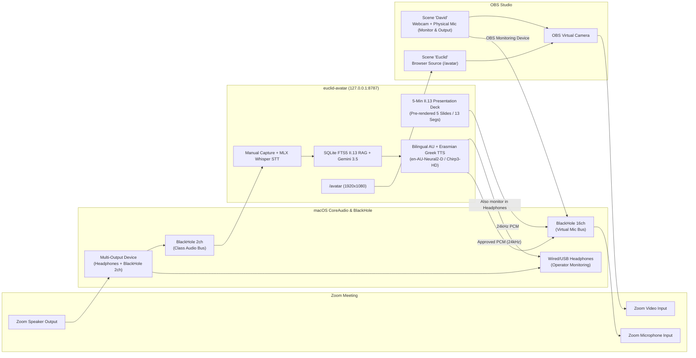

# Euclid Avatar on a Zoom Call · MATH E-139 Group 4 Presentation (*Elements* Book II, Proposition 13)

Live "Euclid of Alexandria" presentation and Q&A avatar pipeline for Harvard Extension School **MATH E-139 (*Reading Euclid's Elements in Greek*, Fall 2026)**, narrowed specifically to **Group 4's presentation on *Elements* Book II, Proposition 13 (`2026-project-ii13`, Greek Section)** for Class 9 (Monday 9 November 2026).

In a live class session on Zoom:
1. **Prepared 5-Minute Presentation Mode (Book II, Proposition 13 Greek Section):**
   - Delivers David Wihl's 5-slide Greek presentation (`2026-project-ii13/greek/slides.qmd` and `writeup.qmd`, encoded in [`presentation_ii13.yaml`](presentation_ii13.yaml)).
   - **Male Australian English (`en-AU`) + Erasmian Ancient Greek (`bird-handout-and-class-2026-10-08`):** Speaks all English narration in an expressive male Australian accent (`en-AU-Chirp3-HD-Charon`, Google Cloud's latest generative HD voice, or `en-AU-Neural2-D`) and seamlessly switches to Erasmian Ancient Greek via locale-calibrated IPA `<phoneme>` tags inside the exact same voice (`google_au_bilingual`), with slow, unhurried recitation of Greek geometric letters (`Α, Β, Γ, Δ`).
   - **Zero-latency playback:** All 5 slides (13 segments) are pre-rendered into 24 kHz mono WAV in `.cache/presentation_ii13/` and `logs/audio/presentation_ii13_full_en-AU-Chirp3-HD-Charon.wav`.
   - **Clean Geometric & Slide Display (`/avatar`, `1920x1080`):** Synchronizes the interactive **Proposition II.13 geometric diagram ($\triangle \mathrm{AB\Gamma}$ with altitude $\mathrm{A\Delta}$)** — dynamically highlighting segments (`ΑΓ`, `ΓΒ`, `ΒΑ`, `ΒΔ`, `ΑΔ`, `ΔΓ`) and vertices (`Α, Β, Γ, Δ`) as they are spoken — with the slide cards, bullet highlights, dual Greek/English subtitles, and a 24-bar acoustic voice waveform in `/avatar` and `/control` (no wooden cartoon avatar bust).
2. **Live Professor Q&A Mode (Professors Paul Bamberg & Graeme Bird):**
   - Captures spoken questions from the Zoom call via `BlackHole 2ch` (or manual text / operator mic override).
   - Local Apple Silicon STT (`mlx-whisper`, pre-warmed in Metal RAM) transcribes the question in **`~120–158 ms`**.
   - An in-memory/SQLite FTS5 BM25 + exact entity retriever queries `.cache/course_index.sqlite` (`3,195` chunks across `381` files from `~/Projects/Courses/26Fall/mathe139/`, including `2026-project-ii13`, `2026-greek-07`, `Elements.pdf`, and `local/recordings/*/transcript.md`) in **`~7.5–12.4 ms`**.
   - A single-pass structured Gemini call (`gemini-3.5-flash-lite` via `google-genai`) generates a concise 2–3 sentence answer in spoken Male Australian English with embedded polytonic Ancient Greek terms/clauses (`~1.7–2.5 s`).
   - **Speculative pre-synthesis:** While you review the transcript, cited course sources, English subtitle track, and Ancient Greek text in the Operator Control window (`/control`), a background worker immediately synthesizes the bilingual Australian English + Erasmian Greek audio sentence-by-sentence into 24 kHz mono PCM in RAM (`~448–710 ms` for Sentence 1).
   - Clicking **Approve & Speak** begins playback into `BlackHole 16ch` (Zoom's microphone) in **`< 0.2 ms`** once Sentence 1 is pre-synthesized, with 5 one-click **Prepared II.13 Q&A Answers** (`canned_responses.yaml`) available at **`~1.1 ms`** latency.

---

## 1. Prerequisites & Installation

### System Dependencies (macOS Apple Silicon `arm64`)
Install the two separate BlackHole virtual audio drivers and FFmpeg via Homebrew:
```bash
brew install blackhole-2ch blackhole-16ch ffmpeg
```
*(Why two separate BlackHole devices? `BlackHole 2ch` carries incoming Zoom class audio into the capture pipeline, while `BlackHole 16ch` carries Euclid's voice into Zoom's microphone input. Keeping them separate prevents Euclid from hearing himself or creating a feedback loop.)*

### Python Environment (`Python 3.12+` via `uv`)
```bash
uv venv --python 3.12 .venv
source .venv/bin/activate
uv pip install -e .
```

### `.env` Configuration
Copy `.env.example` to `.env` (which is gitignored) and configure your local settings:
```bash
cp .env.example .env
```

Documented variables in `.env.example`:
| Variable | Default | Purpose |
| --- | --- | --- |
| `GEMINI_API_KEY` | *(auto-discovered)* | Gemini API key for `google-genai` (falls back to `mathe139/.env` or `euclid-tts/.env`; never logged or committed) |
| `GEMINI_MODEL` | `gemini-3.5-flash-lite` | Low-latency Gemini model (`gemini-3.5-flash-lite`, `gemini-3.1-flash-lite`, `gemini-3-flash-preview`, `gemini-2.5-flash`) |
| `COURSE_REPO_PATH` | `~/Projects/Courses/26Fall/mathe139` | Read-only path to the MATH E-139 course repository |
| `INCLUDE_LOCAL_RECORDINGS` | `true` | Index `local/recordings/*/transcript.md` for lecture/presentation Q&A context |
| `EUCLID_TTS_PATH` | `~/Projects/codex/euclid-tts` | Read-only path to `euclid-tts` (for Kokoro ONNX cache & pronunciation reference) |
| `PRESENTATION_FILE` | `presentation_ii13.yaml` | 5-slide / 13-segment Book II, Proposition 13 Greek presentation script |
| `TTS_BACKEND` | `google_au_bilingual` | `google_au_bilingual` (Male AU English + Erasmian Greek IPA), `google_erasmian`, `kokoro_erasmian`, `google_modern`, or `macos_modern` |
| `TTS_VOICE_ENGLISH` | `en-AU-Chirp3-HD-Charon` | Male Australian voice (`en-AU-Chirp3-HD-Charon`, `en-AU-Chirp3-HD-Orus`, `en-AU-Chirp3-HD-Fenrir`, `en-AU-Neural2-D`, `en-AU-Polyglot-1`) |
| `TTS_VOICE_ERASMIAN` | `en-AU-Chirp3-HD-Charon` | Erasmian IPA voice (`en-AU-Chirp3-HD-Charon`, `en-AU-Neural2-D`, `en-US-Chirp3-HD-Charon`, `en-US-Studio-Q`) |
| `TTS_VOICE_MODERN` | `el-GR-Wavenet-B` | Google Modern Greek voice (`el-GR-Wavenet-B`) |
| `TTS_VOICE_KOKORO` | `bm_george` | Local Kokoro-82M ONNX male voice (`bm_george`, `am_adam`, `af_heart`) |
| `TTS_RATE_ENGLISH` | `0.82` | Speaking rate for Male Australian English narration |
| `TTS_RATE` | `0.72` | Speaking rate for pure Erasmian Greek clauses and Greek geometric letters |
| `TTS_LEVEL_SPEECH` | `true` | Apply `euclid-tts` 2:1 gentle RMS compression & `-1 dBFS` peak limiting |
| `STT_MODEL` | `mlx-community/whisper-large-v3-turbo` | Local Apple Silicon MLX Whisper model (`whisper-large-v3-turbo`) |
| `AUDIO_INPUT_DEVICE` | `BlackHole 2ch` | CoreAudio input device carrying Zoom class audio into capture |
| `OPERATOR_MIC_DEVICE` | `MacBook Pro Microphone` | Physical microphone for operator override / "David" scene |
| `AUDIO_OUTPUT_DEVICE` | `BlackHole 16ch` | CoreAudio output device carrying Euclid speech into Zoom's mic |

### Google Cloud TTS Authentication (for `google_au_bilingual`, `google_erasmian`, and `google_modern`)
Google Cloud TTS uses Application Default Credentials (ADC) cached at startup via `google.auth.default()`:
```bash
gcloud auth application-default login
```
*(If offline or running without Google Cloud credentials, switch `TTS_BACKEND` to `kokoro_erasmian` in `.env` or via the `/control` dropdown for 100% local synthesis.)*

---

## 2. Step-by-Step Audio & Video Routing (macOS + OBS + Zoom)



### Step 1: Verify CoreAudio Devices
Run the built-in device diagnostic:
```bash
.venv/bin/python -m euclid_avatar devices
```
Verify that `BlackHole 2ch`, `BlackHole 16ch`, and your physical microphone/headphones are listed.

### Step 2: Configure macOS `Audio MIDI Setup` (Multi-Output Device)
1. Open **`/System/Applications/Utilities/Audio MIDI Setup.app`** (`⌘+Space` -> `Audio MIDI Setup`).
2. Click the **`+`** button at the bottom-left and choose **Create Multi-Output Device**.
3. Double-click its name and rename it **`Zoom + Euclid Monitor`**.
4. In the right pane, check **both**:
   - Your **Headphones** (e.g., `External Headphones` or `CalDigit Headphone`)
   - **`BlackHole 2ch`**
5. Set **Primary Device** (top dropdown) to your **Headphones**, ensure both devices are set to **`48,000 Hz`**, and check **Drift Correction** next to `BlackHole 2ch`.

### Step 3: Configure OBS Studio Scenes ("David" vs. "Euclid")
Remember that **`OBS Virtual Camera` transmits video only**; Zoom always listens to a single microphone (`BlackHole 16ch`). We use **OBS Audio Monitoring to `BlackHole 16ch`** so switching the video scene automatically switches the active microphone with zero double-audio, echo, or dead air:

1. **Set OBS Monitoring Device:**
   - Open `OBS -> Settings -> Audio -> Advanced`.
   - Set **Monitoring Device** to **`BlackHole 16ch`**.
   - Check **Disable macOS audio ducking**.
2. **Disable Global Desktop/Mic Audio in OBS:**
   - In `OBS -> Settings -> Audio -> Global Audio Devices`, set `Desktop Audio` and `Mic/Auxiliary Audio` to **Disabled**.
3. **Create Scene 1: `David` (Your Webcam + Your Physical Mic):**
   - Add a **Video Capture Device** source for your webcam (`1920x1080`).
   - Add an **Audio Input Capture** source for your physical microphone (`MacBook Pro Microphone` or USB mic).
   - Open `Edit -> Advanced Audio Properties` and set the physical microphone's **Audio Monitoring** to **`Monitor and Output`**.
4. **Create Scene 2: `Euclid` (Avatar Browser Source + Euclid's Voice):**
   - Add a **Browser** source:
     - **URL:** `http://127.0.0.1:8787/avatar`
     - **Width:** `1920`
     - **Height:** `1080`
     - **Custom FPS:** `60`
     - Check **Control audio via OBS** = *unchecked* (the Python pipeline streams approved PCM directly to `BlackHole 16ch` with `< 0.2 ms` post-approval latency).
   - Do **not** add your physical microphone source to Scene `Euclid`.
5. **Configure Hotkeys & Start Virtual Camera:**
   - In `OBS -> Settings -> Hotkeys`, bind **`F9`** to **Switch to scene `David`** and **`F10`** to **Switch to scene `Euclid`**.
   - Click **Start Virtual Camera** in OBS *before* opening Zoom.

### Step 4: Configure Zoom Settings on the MacBook
1. **Video Settings (`Zoom -> Settings -> Video`):**
   - **Camera:** `OBS Virtual Camera`
   - **Original ratio** & **HD:** **Checked**
   - **Mirror my video:** **Unchecked**
2. **Audio Settings (`Zoom -> Settings -> Audio`):**
   - **Speaker:** `Zoom + Euclid Monitor` (Multi-Output Device)
   - **Microphone:** `BlackHole 16ch`
   - **Automatically adjust microphone volume:** **Unchecked**
   - **Audio Profile:** Select **Original sound for musicians** (check *High-fidelity music mode*, uncheck *Echo cancellation* since headphones are worn) and toggle **Original Sound for Musicians: ON** in the top-left of the Zoom meeting window so Erasmian Greek word-initial rough breathings (`/h/`) and word-final fricatives (`/s/`, `/θ/`) are never clipped.

---

## 3. Running the II.13 Presentation & Live Q&A Pipeline

### 1. Build or Update the Local Course Index (`.cache/course_index.sqlite`)
Indexes all `381` course files (`3,195` chunks, `214` entity keys) from `~/Projects/Courses/26Fall/mathe139/` — including `coursework/projects/2026-project-ii13/`, `coursework/assignments/2026-greek-07/`, `Elements.pdf` Book II, `MathNotes08.pdf`, and `local/recordings/*/transcript.md` — into SQLite FTS5 (BM25) + exact entity keys:
```bash
.venv/bin/python -m euclid_avatar index
```

### 2. Pre-Render the 5-Minute Book II, Proposition 13 Presentation Deck
Synthesizes all 5 slides / 13 segments of `presentation_ii13.yaml` in Male Australian English + Erasmian Greek IPA (`309.1 s` / `5.15 min` total with `en-AU-Neural2-D`, or `387.1 s` / `6.45 min` with `en-AU-Chirp3-HD-Charon`):
```bash
.venv/bin/python -m euclid_avatar prebuild-presentation
# Optional: also pre-render with Google's latest generative HD voice:
.venv/bin/python -m euclid_avatar prebuild-presentation --voice en-AU-Chirp3-HD-Charon
```

### 3. Run or Preview the 5-Minute II.13 Presentation from the CLI
```bash
.venv/bin/python -m euclid_avatar present --slide 1
```

### 4. Run the 10-Question Proposition II.13 Professor Q&A Benchmark Suite
Runs 10 representative Professor Q&A questions on Book II, Proposition 13 (`q01_ii13_enunciation` through `q10_ii13_spherical_hyperbolic`), tests the canned II.13 latency floor, benchmarks 9 TTS voice configurations, and writes `logs/turns.jsonl` and `logs/benchmark_summary.json`:
```bash
.venv/bin/python -m euclid_avatar benchmark
```

### 5. Run the Live Avatar & Operator Control Server
```bash
.venv/bin/python -m euclid_avatar serve
```
- **Operator Control Window:** [`http://127.0.0.1:8787/control`](http://127.0.0.1:8787/control)
  - **5-Minute Presentation Deck Controls:** Click **▶ Play All (`5:09`)** to deliver the full 5-slide Greek presentation, **▶ Play Slide** to deliver a single slide (`Slide 1`–`Slide 5`), or **`P`** to **Pause / Resume** (`[ / ]` to step between slides).
  - **Live Professor Q&A Controls:** Hold/toggle **`Space`** (or click **🎙️ Start Capture**) to capture a spoken question from Paul Bamberg or Graeme Bird, or type a question in the manual override box.
  - Review the transcript, retrieved `2026-project-ii13` / `2026-greek-07` citations, spoken Australian English + Greek text, and polytonic Greek quotation while background pre-synthesis runs (`Synthesizing 1/2...` -> `Ready`).
  - Press **`A`** (or click **✅ Approve & Speak**) to speak immediately (`< 0.2 ms`), **`R`** to **Regenerate**, **`Esc`** to **Discard**, or click any of the **5 Prepared II.13 Q&A Answers** (`ii13_verbs`, `ii13_accents_adjectives`, `ii13_misprints`, `ii13_proof_ii7_i47`, `ii13_non_euclidean`) for instant (`~1.1 ms`) playback.
- **OBS Browser Source (`1920x1080`):** [`http://127.0.0.1:8787/avatar`](http://127.0.0.1:8787/avatar)
